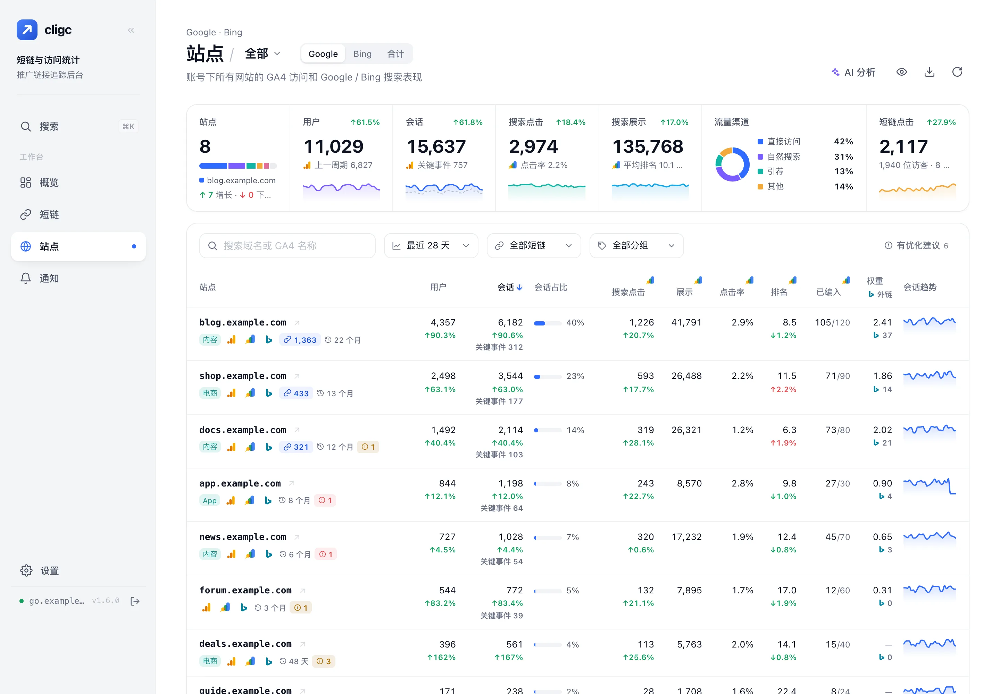
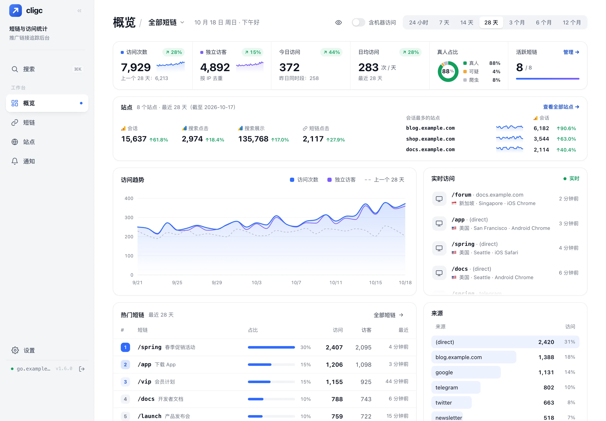
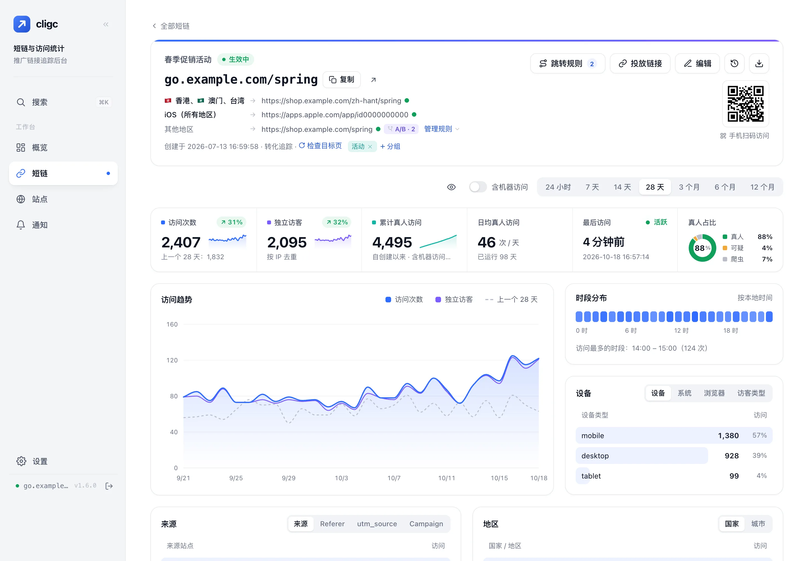
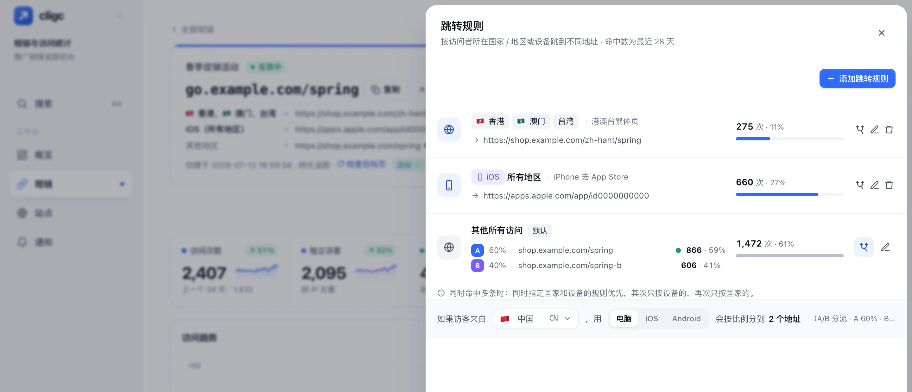
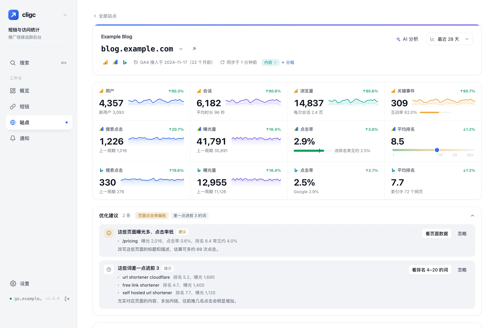

<p align="center">
  
</p>

<h1 align="center">cligc link</h1>

<p align="center">
  免费开源、可自托管的短链接与访问分析服务，运行在 Cloudflare Workers + D1 上。<br>
  按国家 / 地区和设备分流 · A/B 测试 · 目标页健康检查 · 来源追踪 · 实时访问分析 · GA4 与 Search Console 站点分析 · AI SEO 报告 · 免费额度内零成本运行
</p>

<p align="center">简体中文 · <a href="README.en.md">English</a></p>

<p align="center">
  <a href="https://deploy.workers.cloudflare.com/?url=https://github.com/ccvar/cligc_link"></a>
</p>

<p align="center">
  <a href="LICENSE"></a>
  
  
</p>

<p align="center">
  
</p>

---

## 功能

- **短链跳转**：自定义后缀或自动生成，支持停用、有效期、查询参数透传；可按原始链接批量替换目标地址。
- **按国家 / 地区和设备分流**：同一个短链接，不同国家的访客、iPhone / Android / 电脑用户跳到不同落地页（比如 iOS 去 App Store、Android 去应用商店），两者也可以组合；未命中规则的走默认地址。香港、澳门、台湾可单独设置。
- **A/B 测试**：默认地址或任意一条规则都能按比例分到几个落地页，同一位访客总是去同一个版本；配合转化追踪，跳转带上 `utm_content=ab-a / ab-b`，在 GA4 里对比转化。
- **目标页健康检查**：定时检查每个短链的目标地址，打不开（404、5xx、超时等）时在列表里标红并推送到 Telegram / 邮件，恢复后再通知一次。
- **打不开自动回退**：地区链接在访客网络中连不上时（如被拦截），自动改去默认地址，并统计回退次数。
- **定时报告**：日报 / 周报 / 月报按设定时间推送到 Telegram 或邮件（Resend / Cloudflare 邮件路由）。
- **来源追踪**：自动记录 Referer；可选的推广页追踪代码能识别访客来自哪个搜索引擎；为每个投放渠道生成带 `?src=` 的链接，即使对方不发送 Referer 也能分清来源。同时支持 `utm_source` / `utm_campaign`。
- **访问分析**：访问趋势（含上一周期对比）、独立访客、今日访问、来源、国家 / 城市、设备 / 系统 / 浏览器、星期 × 小时热力图、实时访问流、规则命中统计、真人 / 爬虫 / 可疑访问识别，支持导出 CSV。
- **站点分析（GA4 + Search Console）**：连接一个或多个 Google 账号，所有站点按域名合并显示用户、会话、关键事件、搜索点击 / 展示 / 点击率 / 排名及环比，7 天到 12 个月可选；汇总卡片带趋势和访问量占比；支持分组、按增长排序、导出 CSV。
- **Bing Webmaster**：填一个 API Key 即可接入 Bing 的点击、展示、搜索词 / 页面排行和抓取统计，和 Google 的数据按域名合并；站点列表的搜索列可切换 Google / Bing / 合计。网页索引里逐个检查网址是否被 Bing 收录，未收录的可以手动或每天自动提交给 Bing（受 Bing 的每日配额限制）。ChatGPT 搜索、Copilot、DuckDuckGo 都用 Bing 的索引。
- **外链与权重（可选）**：在设置里开启后，每周查一次 Bing 发现的外链（按页面统计，能看到具体来源）和 Open PageRank 域名权重（0–10、全球排名、引用域名数），显示在站点列表和站点详情页。默认关闭，关闭时不发任何请求。
- **网页索引**：列出站点地图（Google / Bing，可一键提交），并逐个检查站点地图和搜索结果里的网址是否被收录、没收录的原因，站点列表显示已编入数。
- **脱敏截图**：概览和站点页右上角的眼睛图标，一键把页面上的域名显示为 `bl•••.com`，方便截图分享。
- **与短链打通**：按访问来源（`?src=` / Referer）统计每个站点带来的短链点击、独立访客和**点出率**；也能看每个短链跳转到哪些站点。可选的**转化追踪**给跳转加上 utm 参数，在 GA4 里看到每个短链的到站会话和关键事件。
- **AI 分析链接**：选好站点一键生成只读报告链接，连同提示词发给 ChatGPT / Claude，报告里预先算好排名 4–20 的词、点击率偏低 / 下滑 / 新出现的词等 SEO 机会；默认 7 天过期、隐藏敏感信息，可查看打开记录、随时撤销。
- **每周 SEO 变化**：每周一推送点击涨跌最多的站点、跌出前 10 和接近前 10 的搜索词。
- **Cloudflare 用量**：后台查看整个账户的 D1 读写和 Worker 请求，按目前速度预测到月底，快超出时推送预警。
- **修改记录与撤销**：每个短链的默认地址、跳转规则、A/B 比例、启用状态等修改都有记录（时间、操作设备、修改前后），保留一年，可以一键撤销。
- **管理后台**：单页应用，中文 / English 界面，支持深色模式和手机访问（触屏上点一下即可查看提示）；⌘K 快速搜索短链、站点和设置；新部署时概览页会给出“开始使用”清单；签名 Cookie 会话、登录设备管理（可退出其他设备）、TOTP 两步验证、登录防暴力破解，可选 Cloudflare Turnstile 人机验证；Google 和 Cloudflare 的凭据可以直接在后台填写（加密保存）。
- **零运维**：无需服务器，表结构在首次请求时自动创建；统计读按小时 / 按天的汇总表，用量很小。“设置 → 系统状态”一页查看定时任务、Google 同步、推送渠道、目标页检查和用量凭据是否正常。

## 截图

**概览：访问趋势、实时访问、来源和热门短链**



**短链详情：跳转规则、二维码和访问分析**



**跳转规则：按国家 / 地区、设备分流，A/B 测试**



**站点详情：GA4、Search Console、Bing 数据和优化建议**



<sub>演示数据，均为虚构</sub>

## 快速部署

### 方式一：一键部署

点击上方 **Deploy to Cloudflare** 按钮，按提示授权即可自动创建 Worker 和 D1 数据库。部署完成后访问 `https://<worker 地址>/admin`，用默认密码 **`admin`** 登录，按提示设置新密码即可。

> 部署后的默认地址是 `*.workers.dev`，**在中国大陆通常打不开**。面向国内访客请先[绑定自己的域名](#绑定自己的域名)，之后复制的短链和二维码都用新域名。

### 方式二：命令行部署

需要 Node.js 18+ 和一个 Cloudflare 账号。

```bash
git clone https://github.com/ccvar/cligc_link.git
cd cligc_link
npm install

# 登录 Cloudflare
npx wrangler login

# 创建 D1 数据库，把输出的 database_id 填到 wrangler.toml
npx wrangler d1 create cligc-link

# 部署
npx wrangler deploy
```

部署后访问 `https://<worker 地址>/admin`，用默认密码 **`admin`** 登录。首次登录会要求设置新密码，设置前后台其他功能都不可用，设置后默认密码立即失效。

> 部署后请尽快登录并修改密码。也可以在部署前用 `npx wrangler secret put ADMIN_PASSWORD` 直接指定初始密码，这样就不会出现默认密码。

### 绑定自己的域名

域名需要托管在 Cloudflare。在 `wrangler.toml` 中添加：

```toml
routes = [
  { pattern = "go.example.com", custom_domain = true },
]
```

重新执行 `npx wrangler deploy` 即可。

用一键部署的：在 Cloudflare 控制台打开 **Workers 和 Pages → 你的 Worker → 设置 → 域和路由 → 添加 → 自定义域**，填入域名即可（同样要求域名托管在 Cloudflare）。之后用新域名打开后台，复制的短链和二维码就会用新域名。

## 升级

每个版本都会打 `vX.Y.Z` 标签、在 [Releases](https://github.com/ccvar/cligc_link/releases) 里写明更新内容（也见 [CHANGELOG.md](CHANGELOG.md)）。后台“设置 → 系统状态”显示当前版本；定时任务每天到 GitHub 查一次最新版本（只读取版本号，不上报任何数据），有新版本时在系统状态里提示，并推送一次到已开启的 Telegram / 邮箱。

数据库不需要手动迁移：新版本第一次运行时会自动补表、补列，数据不会丢失。升级后出问题，可以用 `npx wrangler rollback` 回到上一次部署的代码。

**命令行部署的**：在项目目录执行

```bash
npm run upgrade
```

它会拉取最新发布的版本、保留你在 `wrangler.toml` 里的 Worker 名称、域名、D1 数据库和 `[vars]`、安装依赖，确认后部署。只想先更新代码、检查后再部署：`npm run upgrade -- --no-deploy`；升级到指定版本：`npm run upgrade -- --to v1.2.0`。

**用“Deploy to Cloudflare”按钮部署的**：按钮会在你的 GitHub 下生成一个仓库，并让 Cloudflare 在仓库有新提交时自动部署。打开这个仓库的 **Actions → 同步上游新版本 → Run workflow**，它会把最新版本合并进你的仓库（同样保留 `wrangler.toml` 里的配置），Cloudflare 随后自动重新部署。默认只在你手动运行时升级；想每周一自动升级，把 `.github/workflows/sync-upstream.yml` 里 `schedule` 那两行前面的 `#` 去掉（自动部署的新代码能访问你保存的 Google / Bing 凭据，所以默认不开）。

> 在 v1.1.0 之前部署的，仓库里还没有升级脚本：命令行部署的先 `git pull` 一次（`wrangler.toml` 有冲突时保留自己的数据库 ID 和域名），之后就可以用 `npm run upgrade`；一键部署的把本仓库的 `scripts/` 和 `.github/workflows/sync-upstream.yml` 复制到自己的仓库，再运行上面的 Action。

## 配置

**变量**（写在 `wrangler.toml` 的 `[vars]` 中）：

| 名称 | 说明 |
| --- | --- |
| `HOME_URL` | 访问根路径 `/` 时跳转到的地址；留空则显示内置的产品首页。填了的话还要去掉 `[assets]` 里 `run_worker_first` 前面的 `#`（首页平时是静态文件，不经过 Worker） |
| `ADMIN_HOST` | 后台只允许通过这个域名访问；留空则任意域名的 `/admin` 都可访问 |
| `TURNSTILE_SITEKEY` | Cloudflare Turnstile 站点密钥；留空则登录不做人机验证 |

**密钥**（用 `npx wrangler secret put <名称>` 设置）：

| 名称 | 必填 | 说明 |
| --- | --- | --- |
| `ADMIN_PASSWORD` | 否 | 初始后台密码。不设置时默认为 `admin`，首次登录强制修改 |
| `SESSION_SECRET` | 建议 | 会话签名密钥，也用于加密保存在数据库里的令牌和客户端密钥。不设置时首次运行自动生成并保存在数据库中（这时数据库被导出或泄露，加密的内容也能被解开）；更换后需要在后台重新填写客户端信息、重新连接 Google |
| `TURNSTILE_SECRET` | 否 | Turnstile 服务端密钥，与 `TURNSTILE_SITEKEY` 配套 |

### 把自动生成的会话密钥换成 Secret（推荐）

没设置 `SESSION_SECRET` 时，会话密钥自动生成并存在数据库里；它也用来加密数据库里的 Google 令牌、客户端密钥和 Cloudflare 令牌，所以数据库一旦泄露，这些也能被解开。把**同一个值**改存成 Wrangler Secret，登录状态、已连接的 Google 账号都不受影响：

在项目目录里执行（`<数据库名>` 是 `wrangler.toml` 里的 `database_name`，默认 `cligc-link`）：

```bash
# 1. 读出数据库里的密钥，直接通过管道存成 Secret（不会显示在屏幕上）
npx wrangler d1 execute <数据库名> --remote --json \
  --command "SELECT value FROM settings WHERE key = 'session_secret'" \
  | node -e "let s='';process.stdin.on('data',(d)=>s+=d).on('end',()=>process.stdout.write(JSON.parse(s)[0].results[0].value))" \
  | npx wrangler secret put SESSION_SECRET

# 2. 确认后台还能正常使用后，删掉数据库里的副本
npx wrangler d1 execute <数据库名> --remote --command "DELETE FROM settings WHERE key = 'session_secret'"
```

用一键部署、本地没有项目的：在 Cloudflare 控制台打开 **存储和数据库 → D1 → 你的数据库 → 控制台**，执行 `SELECT value FROM settings WHERE key = 'session_secret'` 并复制结果；再打开 **Workers 和 Pages → 你的 Worker → 设置 → 变量和机密 → 添加**，类型选“密钥”，名称填 `SESSION_SECRET`，值粘贴刚才复制的内容并部署。确认后台正常后，回到 D1 控制台执行 `DELETE FROM settings WHERE key = 'session_secret'`。

注意：如果改用一个**新的**密钥，所有设备会退出登录，需要在后台重新填写 Google 客户端 / Cloudflare 令牌、重新连接 Google 账号。

### 管理员密码

- 生效顺序：后台修改过的密码 > `ADMIN_PASSWORD` > 默认密码 `admin`。
- 在后台“设置 → 修改密码”可随时修改，新密码以 PBKDF2 加盐哈希保存在 D1 中；修改后其他设备的登录会自动失效。
- 忘记密码时，删除数据库中保存的密码即可恢复为 `ADMIN_PASSWORD`（未设置则恢复为默认密码 `admin`，登录后需重新设置），做法见下面的[进不去后台怎么办](#进不去后台怎么办)。

### 登录防暴力破解

- 同一 IP 连续输错 5 次密码会被锁定，锁定时长从 15 分钟起逐次加倍，最长 24 小时；登录成功后清零。IPv6 按 /64 网段计算（一台服务器通常就有一整个 /64，换个地址不能重新计数）。
- 密码以 PBKDF2（10 万次迭代）加盐哈希保存，每次输错还会延迟 0.8 秒响应。
- 配置 Turnstile 后，人机验证在核对密码之前进行，自动化脚本无法批量尝试。
- 开启两步验证后，即使密码泄露也无法登录；动态码连续输错 5 次锁定 15 分钟。
- 自己被锁定时，可以等待解锁，或按[进不去后台怎么办](#进不去后台怎么办)立即解除。

### 登录设备

每次登录记一台设备（浏览器、系统、IP、国家 / 城市、登录时间和最近使用时间），在“设置 → 登录设备”查看。发现不认识的设备，可以单独让它退出，或一键“退出其他所有设备”；修改密码、开启或关闭两步验证时，其他设备也会自动退出。登录有效期 7 天，过期的设备由定时任务清理。

会话 Cookie 里带着设备 ID 和签名，设备记录被删除后这个 Cookie 立即失效。旧版本的登录在升级后第一次访问时会自动登记为一台设备，不需要重新登录。

### 启用 Turnstile（推荐）

1. 在 Cloudflare 控制台 → Turnstile 创建一个组件，域名填你的短链域名。
2. 把站点密钥填到 `wrangler.toml` 的 `TURNSTILE_SITEKEY`。
3. `npx wrangler secret put TURNSTILE_SECRET` 填入服务端密钥，然后重新部署。

### 两步验证（推荐开启）

在后台“设置 → 两步验证”中开启：输入当前密码，用验证器 App（Google Authenticator、Microsoft Authenticator、1Password 等）扫码，再输入一次 6 位动态码确认。开启后登录需要密码 + 动态码，即使密码泄露也无法登录后台、篡改跳转地址。

- 动态码连续输错 5 次锁定 15 分钟；每个动态码只能使用一次。
- 开启或关闭两步验证后，其他设备上的登录会自动失效。
- 手机丢失、无法获取动态码时，按[进不去后台怎么办](#进不去后台怎么办)关闭两步验证，然后用密码登录并重新绑定。

### 进不去后台怎么办

忘记密码、被锁定、手机丢失时，在数据库里执行一条 SQL 即可。两种方式任选：

- **Cloudflare 控制台**（不需要命令行，一键部署的也能用）：打开 **存储和数据库 → D1 → 你的数据库 → 控制台**，粘贴下表的 SQL 执行。
- **命令行**（在项目目录里）：`npx wrangler d1 execute <数据库名> --remote --command "<SQL>"`。`<数据库名>` 是 `wrangler.toml` 里的 `database_name`（默认 `cligc-link`；一键部署时在部署页改过名字的，用你改的名字）。

| 情况 | SQL | 之后 |
| --- | --- | --- |
| 忘记密码 | `DELETE FROM settings WHERE key = 'admin_password'` | 用 `ADMIN_PASSWORD`（没设置则用 `admin`）登录，再设置新密码 |
| 输错密码太多次被锁定 | `DELETE FROM login_guard` | 立即可以重新登录 |
| 动态码输错太多次被锁定 | `DELETE FROM settings WHERE key = 'mfa_fail'` | 立即可以重新输入动态码（不处理也会在 15 分钟后自动解锁） |
| 手机丢失，收不到动态码 | `DELETE FROM settings WHERE key IN ('totp', 'mfa_fail')` | 两步验证已关闭，用密码登录后重新绑定 |

例如忘记密码时用命令行：

```bash
npx wrangler d1 execute cligc-link --remote --command "DELETE FROM settings WHERE key = 'admin_password'"
```

### 统计通知（日报 / 周报 / 月报 / 每周 SEO 变化 / 用量预警）

在后台“通知”页面设置，支持推送到 **Telegram** 和 **邮件**，每个渠道都可以“发送测试”，也可以直接预览报告内容。除了下面的访问报告，还可以开启“每周 SEO 变化”（见“站点”一节）和“Cloudflare 用量预警”（见“Cloudflare 用量”一节）。

- **日报**：每天发送前一天的数据；**周报**：每周一发送上周（周一至周日）的数据；**月报**：每月 1 号发送上个月的数据。
- 报告包含访问次数、独立访客、与上一周期对比、新建短链数、热门短链、主要来源和国家 / 地区。
- 发送时间按后台设置的时区（跟随浏览器）选择整点；由 `wrangler.toml` 中的定时任务每小时检查一次，同一份报告不会重复发送。

**Telegram**：在 Telegram 找 @BotFather 发送 `/newbot` 创建机器人获得 Bot Token；给机器人发一条消息后，访问 `https://api.telegram.org/bot<Token>/getUpdates`，返回中的 `chat.id` 即 Chat ID（群组需先把机器人拉进群并在群里发言）。

**邮件**，二选一：

- **Resend**（推荐）：在 [resend.com](https://resend.com) 验证发件域名并创建 API Key，后台填写 Key、发件人和收件人即可，免费额度每月 3000 封。
- **Cloudflare 邮件路由**：不依赖第三方。先在域名上开通 Email Routing 并验证收件地址，然后在 `wrangler.toml` 中添加绑定并重新部署：

  ```toml
  [[send_email]]
  name = "EMAIL"
  ```

  发件人必须是已开通邮件路由的域名下的地址，收件人必须是已验证的地址。

Bot Token、API Key 保存在 D1 中，后台只显示末 4 位。

## 使用说明

### 跳转规则

每个短链可以先创建、后配置目标地址：

- **默认地址**：没有命中任何规则的访问跳到这里。留空时，这些访问会看到“链接暂不可用”页面。
- **跳转规则**：按访问者所在国家 / 地区（Cloudflare 提供的 `request.cf.country`）、设备（iOS、Android、电脑，按 User-Agent 识别），或两者组合跳到不同地址。不选国家表示所有地区，不选设备表示所有设备。
- **优先级**：国家 + 设备都指定的规则 > 只按设备 > 只按国家 > 默认地址。例如“中国 · Android → 国内应用商店”“iOS → App Store”“中国 → 中文落地页”同时存在时，中国的 iPhone 用户去 App Store，中国的电脑用户去中文落地页。同一类规则之间不能重叠（同一个国家只能属于一条只按国家的规则，以此类推）。

详情页的“如果访客来自 …，用 …”可以检查任意国家 + 设备的跳转结果。

### A/B 分流

在“跳转规则”面板里，默认地址和每条规则右侧都有 A/B 分流按钮：原地址是 A，再加 1–4 个版本（B、C……），每个版本填一个比例（相对数值，如 50 / 30 / 20）。

- 命中这个去向的访问按比例分到各个版本；按访客 IP 分配，同一位访客总是去同一个版本，反复点击不会在几个页面间来回跳。
- 分流地址沿用所属去向的国家 / 设备条件；规则的“打不开时回退”对它的各个版本都有效。
- 各版本的命中数和实际占比显示在“跳转规则”面板里；访问明细会标出访问去了哪个版本。
- 开启**转化追踪**后，跳转额外带上 `utm_content=ab-a`、`ab-b`……，在 GA4 里按“会话手动广告内容”对比各版本的会话和关键事件。
- 分流地址也参与目标页健康检查和批量替换。删除规则时它的分流地址一起删除；取消分流后各版本的访问记录仍保留。

### 修改记录

短链详情页右上角的时钟图标打开“修改记录”：创建、修改默认地址 / 标题 / 备注 / 后缀 / 有效期 / 开关、增删改跳转规则、调整 A/B 分流、批量启用停用、批量替换，每一条都记下时间、操作设备（浏览器 · 系统 · IP）以及修改前后的内容，保留一年。

点“撤销”会改回修改前的内容，撤销本身也记一条记录。只有之后没有再被改过的修改才能撤销（例如默认地址先改成 B、再改成 C，就不能直接撤销“改成 B”那一条），避免把新的修改覆盖掉；删除的规则恢复时沿用原来的规则 ID，之前的命中统计能接上。

### 目标页健康检查

定时任务每小时分批检查已启用短链的默认地址和规则地址（每个地址约 6 小时检查一次，异常的地址 1 小时后复查，单次超时 10 秒）：

- **正常**：返回 2xx / 3xx（会跟随跳转）。
- **打不开**：404 / 410 / 5xx、连接失败或超时。连续两次失败才算异常，避免偶发波动误报。
- **被拦截**：401 / 403 / 429 或 Cloudflare 人机验证页——通常是对方拦截了检查请求，不算异常。

异常的短链在列表状态栏显示“目标异常”（鼠标停留查看原因），详情页每个目标地址旁有状态点，也可以点“检查目标页”立即检查。在“通知”页开启“目标页异常提醒”后，地址变为打不开或恢复时推送到已开启的 Telegram / 邮件渠道。

### 系统状态

“设置 → 系统状态”汇总各项后台任务：上次定时任务的时间和每个步骤的耗时 / 错误、访问汇总进度、Google 账号授权和站点同步、推送渠道、目标页检查、Cloudflare 用量凭据。定时任务超过 3 小时没有运行时，概览页顶部会提示。

### 快速跳转（⌘K）

在后台任意页面按 ⌘K（Windows / Linux 上是 Ctrl K），或点侧栏的“搜索、跳转…”，可以搜索短链（后缀、标题、地址）、站点和各个设置项，方向键选择、回车打开；不输入时列出最近访问的短链。手机上在右上角的账号菜单里打开。

### 界面语言

后台支持简体中文和英文，默认跟随浏览器语言，可以在“设置 → 界面语言”、登录页或 ⌘K 里切换（保存在当前浏览器）。产品首页右上角也能切换，或在地址后加 `?lang=en` / `?lang=zh`。英文界面的词典在 `src/i18n/`，只在英文界面时加载；统计报告、推送消息和 AI 分析报告目前仍是中文。

### 分组与批量操作

短链可以加分组（标签，一个短链可以有多个），列表里按分组筛选，短链详情页可以单独加减分组，“管理分组”里可以改名（同名会合并）和删除。

勾选列表左侧的复选框（表头可以全选本页），底部会出现批量操作栏：启用、停用、加到分组、移出分组、删除。删除会同时删掉跳转规则和访问记录，确认框里会写明影响的访问记录数。

### 批量替换目标地址

推广地址变了（换域名、换推广码）时，在“短链”页右上角点“批量替换”：

- **完全匹配**：地址与原始链接完全一致时，整条换成新链接。
- **包含替换**：只把地址中出现的这一段换掉，其余部分不变，如 `ref=OLD` → `ref=NEW`、`old.example.com` → `new.example.com`。

短链的默认地址、跳转规则和 A/B 分流地址都会处理。执行前会列出每一处“原地址 → 新地址”，并汇总涉及的默认地址、规则 / 分流地址和短链数量；替换后的地址必须是合法的 http / https 地址，确认后才会修改，立即生效。

### 来源统计

来源的判定优先级：`src` 参数 > `utm_source` > Referer 域名 > `(direct)`。

**推荐用 `?src=` 区分渠道。** 在详情页“高级设置 · 按站点生成投放链接”里输入站点名，会为每个渠道生成形如 `https://go.example.com/spring?src=zhihu` 的链接。`src` 写在链接本身里，不受对方网站或 App 的任何设置影响，是最可靠的来源标记。连接了 Google 后，可以点“从站点列表添加”直接选站点，`src` 用站点域名，“站点”页就能把点击准确算到这个站点。

**放到网页上时，不要给链接加 `rel="noreferrer"`。** Referer 是浏览器在跳转时告诉短链“访客从哪个网站来”的请求头，链接加了 `noreferrer` 就不会发送，Referer 统计会记成直接访问。推荐写法（每条投放链接旁的 `<>` 按钮可一键复制）：

```html
<a href="https://go.example.com/spring?src=zhihu" target="_blank" rel="noopener">活动详情</a>
```

`rel="noopener"` 防止新打开的页面操控原页面，可以保留；只是不要再加 `noreferrer`。

即使不加 `noreferrer`，以下情况浏览器也不会发送 Referer，统计会记为 `(direct)`：

- 对方页面或整站设置了 `referrerpolicy="no-referrer"` / `Referrer-Policy: no-referrer`；
- 在微信、QQ、微博等 App 内打开，或从邮件客户端、文档中点击；
- 从 https 页面跳到 http 页面。

另外，出于隐私保护，浏览器跨站跳转时默认只发送来源网站的域名（如 `www.zhihu.com`），不包含具体页面路径。所以 Referer 适合看“来自哪个网站”，要区分同一网站上的不同投放位置，请使用不同的 `src`，例如 `?src=zhihu-answer`、`?src=zhihu-column`。

### 来源追踪（可选）

访客先从搜索引擎进入你的推广页，再点页面上的短链时，短链只能看到“来自推广页”。在后台“设置 → 来源追踪”开启后，把后台给出的**完整代码**粘贴到推广页里（推荐：在访客浏览器里运行，不占 Worker 请求额度），它会识别访客来自哪个搜索引擎（Google、Bing、百度、搜狗、360、神马等）或广告点击（`gclid` / `msclkid`），并给指向短链的链接加上 `utm_source`：

也可以只放一行 Script 链接，规则更新后不用重新粘贴，但每个新访客加载一次就占一次 Worker 请求（和短链跳转共用免费版每天 10 万次的额度），流量大的页面建议用完整代码：

```html
<script src="https://go.example.com/t.js" async></script>
```

- 只处理指向短链域名的链接；链接上已有的 `src`、`utm_source` 不会被改动。
- 记住访客首次进入时的来源（sessionStorage），在站内翻页后再点短链也不会丢。
- 在短链详情页“来源 · utm_source”查看；链接没有 `src` 时，`utm_source` 也会直接计入“来源”。
- 关闭开关后 `/t.js` 不再生效（访客浏览器里已缓存的要等缓存过期），已粘贴的完整代码不受影响。
- 搜索引擎都不再传递搜索关键词，因此只能知道是哪个搜索引擎，看不到具体关键词。

### 真人 / 机器访问识别

每次访问都会被标记为 **真人**、**爬虫** 或 **可疑**，并记录判定原因：

- **爬虫**：User-Agent 自报身份，如 Googlebot、百度蜘蛛、微信 / Telegram 链接预览、curl、Python 脚本。
- **可疑**：满足下面任一条——
  - 命中一个强信号：没有 Accept-Language、同一 IP 1 分钟内访问同一短链 5 次以上、TLS 1.0 / 1.1；
  - 同时命中两个弱信号：自称新版 Chrome / Firefox 却缺少 `Sec-Fetch-*` 请求头、使用 HTTP/1.x、自称很旧的系统或浏览器版本（如 iOS 13、Chrome 100 以下）；
  - 来自机房 IP，并且带有上面任一机器特征。微信等 App 的链接安全检测、各类监控和爬虫通常属于这一类。
- **真人**：其余访问。

后台顶部“含机器访问”关闭时，统计、实时访问和定时报告都只算真人。概览的“真人占比”、短链详情页“设备 · 访客类型”显示构成和原因；实时访问和访问明细里，爬虫 / 可疑 / 经代理的访问带标签，鼠标停留查看原因。升级后会按已有的 IP、运营商、User-Agent 自动重新判定旧记录。

#### 机房 IP 的识别

按 ASN 编号识别常见云厂商（腾讯云、阿里云、华为云、火山引擎、百度云、AWS、Google Cloud、Azure、DigitalOcean、Vultr、Hetzner、OVH、Contabo 等），并按运营商名称补充识别其他机房和托管商。有些云厂商用公司地址登记 IP（如腾讯云新加坡登记为“6 COLLYER QUAY”），只看名称会漏掉，所以以 ASN 为准。

Cloudflare 和 Akamai 的 IP 不算机房：iCloud 私密中继和 Cloudflare WARP 的真人用户也走它们。

#### VPN / 代理识别

VPN 和“机场”节点大多架在机房里，所以“来自机房 IP”本身不能说明是机器。经代理访问的真人会被单独标出，仍计入真人：

| 情况 | 判定 | 标签 |
| --- | --- | --- |
| 机房 IP，浏览器特征完整（HTTP/2 或 HTTP/3、请求头齐全、系统和浏览器版本不旧） | 真人 | 代理 · 经 VPN / 代理 |
| 机房 IP，并带有任一机器特征（如 HTTP/1.1、缺少请求头、iOS 13 之类的旧版本） | 可疑 | 可疑 |
| 中文访客（Accept-Language 为 zh）出现在中国大陆、港澳台、新加坡、马来西亚以外的地区 | 真人 | 代理 · 可能经 VPN / 代理（仅提示） |

概览的“真人占比”旁会显示其中经代理的次数，短链详情页“访客类型”显示经代理的真人占比，导出的 CSV 中 `proxy` 列为 1 表示经代理。

升级前的旧记录没有保存连接协议，无法判断浏览器特征是否完整，来自机房 IP 的旧记录仍按可疑处理；之后的新访问都会正常区分。

#### 局限

这些都是基于网络特征的推断：住宅代理、手机热点、企业网关的 IP 和普通宽带一样，无法识别为代理；通过它们运行的自动化脚本也可能被判为真人。Cloudflare 的机器人评分（Bot Management）仅企业版提供，这里没有使用。识别结果只用于统计，不会改变任何访客的跳转结果。

### 数据保留与统计汇总

每次访问都会记录一条明细。统计页面（7 天及以上的范围）不再每次扫描全部明细，而是读按小时 / 按天汇总的数据，大幅减少 D1 的读取量（免费版每天 500 万行）；最近不到一小时的访问直接读明细，统计始终实时。24 小时范围仍直接读明细。

- 汇总表：`agg_h`（每小时访问次数）、`agg_d`（每天各维度的访问次数：来源、国家、城市、设备、浏览器、系统、规则命中、访客类型等）、`agg_uv`（每天的独立访客，用 HyperLogLog 估算，误差约 5%）。
- 汇总在统计请求和每小时的定时任务里增量进行，无需手动操作；访客类型规则调整后会自动按保留的明细重建。
- 在后台“设置 → 数据保留”可以选择访问明细保留 60 / 90 / 180 / 365 天或永久（默认永久）。超过期限的明细由定时任务每小时清理一批：免费版每次最多 500 条（一天最多约 1.2 万条）；在“Cloudflare 用量”里选了（或自动识别为）付费版时每次最多 2 万条。每删一条明细约占 4 行写入（表本身加 3 个索引），所以免费版清理积压期间每天最多约占 4.8 万行写入，大约是免费额度的一半；积压要删几天取决于积压多少和每天的访问量，后台会显示预计还要多久。每天访问几千次以上的免费版站点，开启前先在“设置 → Cloudflare 用量”看一下写入余量。趋势、来源、地区等统计读汇总数据，不受影响。访问明细列表、导出 CSV 和定时报告只包含仍保留的明细。

### 站点：GA4 与 Search Console

后台“站点”页连接 Google 账号后，会列出账号下所有的 GA4 媒体资源和 Search Console 站点（按域名自动配对），显示用户、会话、关键事件、搜索点击、展示、点击率、平均排名及趋势；站点详情页有每日趋势、搜索词 / 页面 / 国家 / 设备排行（搜索词显示和上一周期比的排名变化，可以筛出排名 4–20、点击率偏低、下滑和新出现的词）、GA4 来源 / 媒介 / 页面排行和实时在线人数。

站点详情页的“网页索引”卡片：列出站点地图（状态、错误、上次读取，可一键重新提交），并用 URL Inspection API 逐个检查站点地图和搜索结果里的网址（每个站点最多 500 个，定时任务每小时查一批、各站点轮流，已编入的 7 天复查一次），汇总出已编入 / 未编入和未编入的原因；每个网址可跳到 Search Console 请求编入索引。GA4 只申请只读权限；Search Console 申请 `webmasters` 权限（读取 + 提交站点地图），早先只授予只读权限的账号重新连接一次即可。

配置（每个部署需要自己的 OAuth 客户端）：

1. 在 [Google Cloud 控制台](https://console.cloud.google.com/) 新建项目，启用 **Google Analytics Admin API**、**Google Analytics Data API**、**Google Search Console API**、**Site Verification API**（把新站点接入 Search Console 时验证所有权用）。
2. “OAuth 权限请求页面”：用户类型选“外部”，填写应用名称和邮箱，然后点 **发布应用**。未发布（测试状态）的应用授权 7 天后失效；个人使用无需 Google 审核，授权时如果出现“Google 未验证此应用”，点“继续”；没有“继续”按钮时，先点“高级”，再点下面的“转到…（不安全）”。这是你自己创建的应用，可以放心继续。
3. “凭据 → 创建凭据 → OAuth 客户端 ID”，类型选 **Web 应用**，已获授权的重定向 URI 填 `https://<你的域名>/api/google/callback`。
4. 打开后台“设置 → Google 集成”，填写客户端 ID 和客户端密钥并保存（密钥加密保存在 D1，之后只显示末 4 位）。
5. 到“站点”页点“连接 Google 账号”完成授权。

把新站点接入 Search Console / Bing：站点列表右上角“+ → 接入 Search Console / Bing”，或者站点详情的“接入搜索引擎”。先验证网站所有权，再添加站点、提交站点地图。“设置 → Cloudflare”的令牌带上“区域 · DNS · 编辑”权限后（和看用量共用一个令牌，也可以单独填一个只管 DNS 的），域名在这个 Cloudflare 账号里的站点会自动加验证用的 DNS 记录（Google 一条 TXT，验证整个域名；Bing 一条 CNAME），网站代码不用改；不在 Cloudflare 的用页面 meta 标签验证。DNS 还没生效时定时任务每小时会再试。

客户端可以在“设置 → Google 集成”里修改或删除；更换客户端 ID 会断开所有已连接的账号。旧版本写在环境变量（`GOOGLE_CLIENT_ID` / `GOOGLE_CLIENT_SECRET`）里的客户端，升级后第一次用到时会自动导入后台，之后可以把环境变量删掉。

列表上方汇总当前筛选的站点数（及增长 / 下降的站点数）、用户、会话、关键事件、搜索点击和短链点击，表格里有每个站点的会话（或搜索点击）占比。

**与短链打通**（两个方向）：
- **站点上的推广短链**（主要）：按短链访问的来源匹配站点——`?src=` / `utm_source` 优先，其次 Referer 域名；来源是域名时按域名（含子域名、忽略 www.）匹配，是不带点的名字（如 `?src=gaterar`）时与站点主名称相同才算。站点列表、汇总卡片和站点详情页显示从站点点出的短链真人点击、**访客数**（按 IP 去重，HyperLogLog 估算，误差约 5%；汇总表 `agg_suv` 按天 × 短链 × 来源保存，旧数据由定时任务一次性回填）和**点出率**（短链点击 ÷ 会话）；短链详情页的“来源站点”列出这个短链从哪些站点被点进来。
- **跳转到这个站点的短链**：按短链的跳转地址（默认地址、每条跳转规则和 A/B 分流地址）的域名匹配站点，在站点详情页和短链详情页的“目标站点”显示。
- 站点列表可以按短链筛选（两个方向都算）。

**分组**：站点可以加分组（标签，一个站点可以有多个）。列表里按分组筛选；先搜索或筛选出站点，再从分组下拉里“给当前筛选的站点加分组”批量添加；站点详情页可以单独加减分组；“管理分组”里可以改名（同名会合并）和删除。汇总、导出、AI 分析都跟随分组筛选。

**导出**：右上角的下载图标把当前筛选和排序的列表导出为 CSV（UTF-8，Excel 可直接打开）。

**每周 SEO 变化**：在“通知”页开启后，每周一在发送时间推送：搜索点击 / 展示 / 会话的周对比、点击涨跌最多的站点、跌出前 10 和接近前 10 的搜索词（只查展示最多的 10 个站点）。Search Console 数据延迟约 3 天，所以搜索对比的是 3–9 天前的一周；可以只看某个分组，也可以先“预览”。

**转化追踪**（每个短链单独开启，默认关闭）：跳转时给目标地址加上 `utm_source=cligc&utm_medium=shortlink&utm_campaign=<短链后缀>`（目标地址已经带 utm 参数时不改动）。短链详情页的“目标站点”会显示 GA4 里对应的到站会话、到达率（到站会话 ÷ 真人点击）和关键事件。

站点列表的结果缓存 5 分钟，Google 同步、访问汇总、短链或分组有变化时自动失效。

可以连接多个 Google 账号：在“站点”页右上角点“添加账号”，授权时选择另一个账号即可；已连接的账号在“设置 → Google 集成”里查看、断开或重新连接。所有账号的站点按域名合并显示（同一个域名可以 GA4 来自一个账号、Search Console 来自另一个账号；多个账号都能看到同一个站点时用最早连接的账号），列表可以按账号筛选。每个账号可以单独断开，只来自这个账号的站点和数据会删除；某个账号授权失效时只影响它自己，点“重新连接”即可。

刷新令牌用会话密钥加密后保存在 D1。每日数据由定时任务每小时分批同步（每个站点最多 6 小时同步一次，首次回填 16 个月，即 Search Console 保留数据的上限）；详情页的排行和实时在线人数打开时现查，缓存 1 小时。时间范围可选最近 7 / 14 / 28 天、3 / 6 / 12 个月，截至昨天，和上一周期对比（12 个月不做对比）；Search Console 数据通常延迟 2–3 天。

### Bing Webmaster

在 [Bing Webmaster Tools](https://www.bing.com/webmasters) 添加站点（已在 Search Console 验证的可以一键导入），到 **设置（齿轮）→ API 访问 → API Key** 生成 Key，填到后台“设置 → Bing Webmaster”。之后：

- 定时任务每天列一次 Bing 账号里的站点，按域名和 GA4 / GSC 合并；每 12 小时同步一次每日点击 / 展示和“索引中的网页数”。
- 站点详情页多出 Bing 的数据卡片、趋势线、搜索词 / 页面排行（Bing 按周汇总）和抓取统计 / 抓取问题。
- 网页索引卡片用 `GetUrlInfo` 检查每个网址是否在 Bing 索引里（Bing 限流较严，每小时约检查 36 个，已收录的 30 天复查一次、未收录的 7 天），可以逐个或批量提交；“自动提交”默认开启，每天把未收录、30 天内没提交过的网址按配额提交。
- AI 分析报告和每周 SEO 变化里也会带上 Bing 的数据。

**Bing 提示“按 IP 限流”怎么办**：Bing 会按来源 IP 限流，Cloudflare Workers 的出口 IP 是很多网站共用的，常被拦下。在自己的服务器上加一条转发，然后在“设置 → Bing Webmaster”里填上代理地址（`https://你的域名/bing-随机字符/`），Bing 请求就会从那台机器发出。准备一个域名指向这台服务器（托管在 Cloudflare 的话设成“仅 DNS”），放开 80 / 443 端口。Caddy 示例（会自动申请 https 证书；nginx 的写法和自测命令在后台的“怎么搭代理”里，路径里的随机字符也会自动生成）：

```caddy
bing.example.com {
    handle_path /bing-换成一串随机字符/* {
        rewrite * /webmaster/api.svc/json{uri}
        reverse_proxy https://ssl.bing.com {
            header_up Host ssl.bing.com
        }
    }
}
```

然后代理地址填 `https://bing.example.com/bing-那串字符/`。代理地址必须是 https（API Key 在请求参数里），路径里放一串别人猜不到的随机字符。

### 站点优化建议

站点页根据已经同步的数据自动给出优化建议（不额外调用外部接口）：GA4 最近几天突然没有数据、搜索点击明显下滑、曝光多但点击率低、收录率低（附主要原因和做法）、有打不开或被屏蔽的网址、站点地图读取失败或没有提交、Bing 收录明显比 Google 少、有流量但没有设置转化；站点详情页还会列出曝光多但点击率低的页面、排名 4–20 差一点进前 3 的词。每条建议带具体数字和建议做法，按重要程度排序，点“看…”直接跳到对应的数据。曝光、会话太少的站点不提醒。

站点列表里有建议的站点会带一个小标记，筛选栏的“有优化建议”只看这些站点。某条建议不需要处理时可以“忽略 30 天”或“不再提醒”，之后在同一张卡片里能恢复。

### 外链与权重（可选）

在“设置 → 外链与权重”里开启，两项可以分别开关，默认都关闭；关闭时不发任何请求，站点页也不显示。

- **Bing 外链**：需要先配置 Bing Webmaster（不另外收费）。每个站点每周用 `GetLinkCounts` 查一次 Bing 发现的、从其他网站链到这个站点的链接数（按页面统计，每个站点最多翻 5 页、保存外链最多的 50 个页面），每次定时任务最多查 10 个站点，避免触发 Bing 的限流。在站点详情页点开某个页面，会用 `GetUrlLinks` 现查具体是哪些网址链过来的（缓存一天）。
- **Open PageRank**：由 Keywords Everywhere 提供，按 Common Crawl 公开数据计算的域名权重（0–10），附带全球排名、引用域名数和近一年的每月分数。到 [keywordseverywhere.com/openpagerank](https://keywordseverywhere.com/openpagerank) 免费注册，生成以 `opr_live_` 开头的 API Key 填进去即可（加密保存）。免费版每月可查 3 万个域名，每次请求查 100 个；这里每周查一次，150 个站点每月约用 650 个。

开启后，站点列表多出“权重 / 外链”一列（可以排序），站点详情页多出“外链与权重”卡片。注意：Open PageRank 不是 Google PR（已停用多年），也不是 Ahrefs 的 DR 或 Moz 的 DA，几种指标不能直接比较；新站通常查不到分数，外链也要几周到几个月才会被 Bing 发现。

### AI 分析链接

在“站点”页（或站点详情页）右上角点“AI 分析”，选择站点（一个或多个，最多 100 个；超过 30 个时报告自动使用精简格式，每个站点只保留核心指标和搜索机会）、时间范围（28 天 / 3 个月 / 6 个月）和包含的内容，生成一个只读链接，发给 ChatGPT、Claude 等 AI，让它分析这些站点的 SEO。

- 链接返回给 AI 读的 Markdown 报告（`?format=json` 为结构化数据，`?download=1` 下载文件）：概览、站点对比、核心指标与环比、趋势、搜索词 / 页面、国家 / 设备，以及预先算好的**机会**——排名 4–20 的高展示词、点击率明显低于该排名常见水平的词、点击下滑的词和页面、新出现的词；GA4 的渠道、来源 / 媒介、着陆页和互动率；跳转到这些站点的短链。
- 生成后可以一键复制“给 AI 的提示词”（已带上链接）。有些 AI 不能打开链接，可以下载 Markdown 文件后上传。
- 安全：链接用 128 位随机 token，只读、只包含选中的站点；默认 7 天后过期（可选 30 天 / 永久），默认隐藏 Google 账号邮箱、GA4 媒体资源 ID 和 Search Console 资源名；每个链接每小时最多打开 60 次；响应带 `X-Robots-Tag: noindex`，不会被搜索引擎收录（`robots.txt` 允许抓取 `/r/`，否则 AI 工具打不开）。
- 报告缓存 1 小时，创建链接后会先在后台生成一次，AI 第一次打开就很快。
- 在“设置 → AI 分析链接”查看所有链接的打开次数和被哪些工具打开过（按 User-Agent 识别 ChatGPT、Claude、Perplexity、Gemini 等），点打开次数可以看每次打开的时间、来源工具、国家和 IP（每个链接保留最近 200 条），可随时撤销。

### Cloudflare 用量

后台“设置 → Cloudflare 用量”显示整个账户的 D1 读写行数、Worker 请求数和 D1 存储，并单独列出本项目的用量（在面板里填写本项目的 D1 数据库 ID 和 Worker 名称）；每天的用量还会列出占用最多的数据库和 Worker（显示数据库名称需要令牌另有 **账户 · D1 · 读取** 权限，否则显示数据库 ID）。免费版对比每天的额度（UTC 0 点重置），付费版对比本月累计与每月包含额度；套餐可自动识别，也可在面板里手动指定。需要：

1. 在 Cloudflare 控制台创建自定义 API 令牌，权限 **账户 · Account Analytics · 读取**（可选 **账户 · 账单 · 读取**，用于显示是否为付费版）。
2. 在面板里填写账户 ID 和令牌（可选填 D1 数据库 ID、Worker 名称，用于单独显示本项目用量），点“验证并保存”。保存前会先请求一次 Cloudflare 接口确认令牌有效；令牌加密保存在 D1，之后只显示末 4 位。

旧版本写在环境变量（`CF_ACCOUNT_ID` / `CF_API_TOKEN` / `D1_DATABASE_ID` / `WORKER_NAME`）里的凭据，升级后第一次用到时会自动导入后台，之后可以把环境变量删掉。

面板会按目前速度推算到期末的用量（付费版按最近 7 天日均推算到月底，免费版推算到今天结束），显示是否够用、预计哪天用完包含额度。

**用量预警**：在“通知”页开启“Cloudflare 用量预警”，选择阈值（已用 70% / 80% / 90%）。定时任务每小时检查一次，已用达到阈值、已超出包含额度，或按目前速度到期末会超出时，推送到已开启的 Telegram / 邮件渠道；同一计费周期里每项指标的每种情况只提醒一次。

结果缓存 5 分钟，可手动刷新。

## 测试

```bash
npm test
```

用 Node 自带的测试工具（不需要额外依赖），覆盖访客识别、UA 解析、设备识别与跳转规则优先级、A/B 分流比例、24 小时统计工具、用量预测、HyperLogLog 独立访客估算、站点匹配和 AI 报告的规则。不依赖 Workers 运行环境的逻辑放在 `src/lib.js`，方便直接测试。

## 本地开发

```bash
npm install
cp .dev.vars.example .dev.vars   # 按需去掉行首的 #
npm run dev                      # http://localhost:8787/admin
```

本地默认不启用人机验证、密码是 `admin`；想在本地试 Turnstile，把 `.dev.vars` 里 `TURNSTILE_SITEKEY` 和 `TURNSTILE_SECRET` 两行都取消注释（Cloudflare 提供的测试密钥，验证总会通过）。

## 项目结构

```
src/index.js      Worker：跳转、访问记录、后台 API、定时任务、自动建表
src/lib.js        不依赖 Workers 环境的纯逻辑：访客识别、跳转规则与 A/B 分流、24 小时统计工具、用量预测
src/agg.js        访问汇总（按小时 / 按天）、独立访客 HyperLogLog
src/google.js     Google 集成：OAuth、GA4 / Search Console 同步、站点与短链匹配、AI 报告、每周 SEO 变化
src/bing.js       Bing Webmaster：API Key / 代理、每日数据同步、搜索词与抓取统计、收录检查与提交
src/gindex.js     网页索引：站点地图、Google 网址检查、Bing 收录检查与自动提交
src/backlinks.js  外链与权重（可选）：Bing 外链、Open PageRank 域名权重
src/advice.js     站点优化建议：按已同步的数据判断问题，忽略记录
src/admin.html    管理后台（单文件，无构建步骤）
src/home.html     根路径产品首页（部署时生成静态文件到 public/，Cloudflare 直接返回，不占 Workers 请求额度）
src/i18n/         英文界面：翻译脚本（client.js）和后台 / 首页的词典
test/             node --test 测试
schema.sql        数据库表结构（首次请求时自动执行）
migrations/       旧版本数据库的升级脚本
wrangler.toml     Cloudflare 配置模板
scripts/          升级脚本（npm run upgrade）：拉取新版本并保留 wrangler.toml 里的个人配置；build-assets.mjs 生成静态首页；demo-data.mjs 生成虚构的演示数据，screenshots.mjs 用它截 README 里的截图
docs/screenshots/ README 截图（演示数据）
.github/workflows/ 一键部署仓库用的“同步上游新版本”任务
CHANGELOG.md      更新日志
```

## 免费额度

只使用 Workers 和 D1。Cloudflare 免费版每天 10 万次 Worker 请求、D1 每天 500 万行读取 / 10 万行写入、5 GB 存储，个人和小团队通常用不完。

最先用完的通常是 **D1 写入**：每次访问写一条访问明细，D1 按行计费时它的 3 个索引、自增序号也各算一行，加上短链的访问计数和每小时汇总，**平均每次访问约占 10 行写入**（短链多、访问分散时汇总占得更多）。所以免费版每天大约能完整记录几千到一万次访问。**超过当天的读取或写入额度后，D1 当天不能再查询：短链会显示“暂时不可用”页面，后台也打不开**，UTC 0 点（北京时间早上 8 点）额度重置后自动恢复。后台“设置 → Cloudflare 用量”可以查看用量，在“通知”页可以开启用量预警，快用完时提前提醒。访问量更大时建议升级 Workers 付费版（每月 5 美元，含每月 5000 万行写入）。

另外，删除短链会一并删掉它的全部访问明细，每条约占 4 行写入：一次删掉几万条访问记录就可能直接用完当天的写入额度，让所有短链当天暂停跳转。只是不想让它再跳转的话，先停用。

## 许可证

[MIT](LICENSE)
